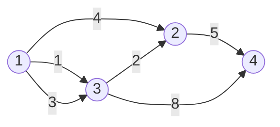
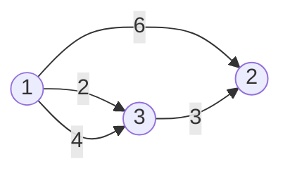

# Acompanhamento dos Marcos

# Marco 1 — Formulação

## 1. Enunciado

Existem `n` cidades e `m` conexões de voo. Cada voo sai de uma cidade `a`, chega a uma cidade `b` e tem um comprimento `c`. Os voos são só de ida.

O problema pede a **menor distância** da cidade `1` (Syrjälä) até cada uma das `n` cidades. É garantido que todas as cidades podem ser alcançadas a partir da cidade `1`.

## 2. Entrada

A primeira linha contém dois inteiros:

* `n` — quantidade de cidades, numeradas `1, 2, …, n`;
* `m` — quantidade de conexões de voo.

Em seguida, são fornecidas `m` linhas com três inteiros `a`, `b` e `c`:

| Valor | Significado |
|-------|-------------|
| `a` | cidade de origem do voo |
| `b` | cidade de destino do voo |
| `c` | comprimento (custo) do voo |

## 3. Saída

Uma única linha com `n` inteiros: a menor distância da cidade `1` até as cidades `1, 2, …, n`, nessa ordem.

A distância da cidade `1` até ela mesma é sempre `0`.

## 4. Objetivo

Para cada cidade `v`, encontrar o menor valor possível da soma dos comprimentos dos voos de uma rota que sai de `1` e chega em `v`.

## 5. Restrições

* `1 ≤ n ≤ 10⁵`;
* `1 ≤ m ≤ 2 · 10⁵`;
* `1 ≤ a, b ≤ n`;
* `1 ≤ c ≤ 10⁹`;
* limite de tempo: 1 s; limite de memória: 512 MB.

Como `c` pode chegar a `10⁹` e uma rota pode ter muitos voos, as distâncias podem passar do limite de um inteiro de 32 bits. Por isso, as distâncias precisam ser guardadas em inteiros de 64 bits (`long`).

## 6. Modelagem como Grafo

* **Vértices:** as cidades;
* **Arestas:** os voos, dirigidos de `a` para `b`;
* **Peso:** o comprimento `c` do voo;
* **Origem:** a cidade `1` (Syrjälä);
* **Tipo:** grafo dirigido e ponderado, com pesos positivos.

O grafo é dirigido porque existir o voo `a → b` não garante o voo `b → a`. O enunciado não proíbe voos repetidos entre as mesmas cidades, então podem existir **várias arestas** entre o mesmo par, com pesos diferentes. O grafo não é necessariamente simples.

## 7. Resultado de Aprendizagem

O problema afere o conceito de **caminho mínimo de origem única** em grafos ponderados. Diferente do T1 e do T2, não basta saber *se* uma cidade é alcançável, nem contar quantos passos são dados: o que importa é a **soma dos pesos** do caminho.

Um caminho com mais voos pode ser mais curto que um voo direto, se a soma dos seus pesos for menor. O algoritmo usado para encontrar essas distâncias é definido no marco 3.

## 8. Instância Pequena (criada pelo grupo)

Instância com 4 cidades e 6 voos, montada para ter os casos que importam no problema: um voo repetido e caminhos com mais voos que são mais baratos que o voo direto.

Entrada:

```text
4 6
1 2 4
1 3 1
1 3 3
3 2 2
2 4 5
3 4 8
```

| Voo | Origem | Destino | Comprimento |
|-----|--------|---------|-------------|
| 1 | 1 | 2 | 4 |
| 2 | 1 | 3 | 1 |
| 3 | 1 | 3 | 3 |
| 4 | 3 | 2 | 2 |
| 5 | 2 | 4 | 5 |
| 6 | 3 | 4 | 8 |



Saída esperada:

```text
0 3 1 8
```

* Cidade `1`: distância `0`, pois é a origem;
* Cidade `3`: entre os dois voos `1 → 3`, o de peso `1` é o melhor;
* Cidade `2`: o voo direto custa `4`, mas `1 → 3 → 2` custa `1 + 2 = 3`;
* Cidade `4`: o melhor caminho usa **três** voos, `1 → 3 → 2 → 4`, com custo `1 + 2 + 5 = 8`.

## 9. Exemplo do Enunciado

```text
3 4
1 2 6
1 3 2
3 2 3
1 3 4
```



Saída esperada:

```text
0 5 2
```

* Cidade `1`: distância `0`, pois é a origem;
* Cidade `2`: o voo direto custa `6`, mas a rota `1 → 3 → 2` custa `2 + 3 = 5`;
* Cidade `3`: existem dois voos `1 → 3`, com pesos `2` e `4`; o melhor é `2`.

---

# Marco 2 — Representação e Validação

## 1. Representação escolhida

Foi escolhida a **lista de adjacência**: cada cidade guarda a lista dos voos que **saem** dela.

Os motivos são:

* o grafo é **esparso**: `m ≤ 2 · 10⁵` é muito menor que `n² = 10¹⁰`. Uma matriz de adjacência `n × n` não caberia na memória;
* a lista ocupa `O(n + m)`, proporcional ao tamanho da entrada;
* para encontrar caminhos mínimos, a operação mais usada é "percorrer os voos que saem de `v`", e a lista entrega exatamente isso;
* a lista aceita **arestas paralelas** naturalmente. Uma matriz guardaria só um peso por par `(a, b)` e perderia informação.

## 2. Estrutura dos dados

Diferente do T2, a aresta agora carrega um **peso**. Por isso, cada item da lista de uma cidade guarda dois valores:

| Campo | Significado |
|-------|-------------|
| `destino` | cidade `b` onde o voo chega |
| `peso` | comprimento `c` do voo |

Ao ler a linha `a b c`, o par `(b, c)` é adicionado **apenas** à lista de `a`. Ele não é adicionado à lista de `b`, porque o voo é só de ida.

## 3. Representação da instância pequena

Lista de adjacência no formato `destino (peso)`:

```text
1: 2 (4), 3 (1), 3 (3)
2: 4 (5)
3: 2 (2), 4 (8)
4:
```

* A cidade `1` tem três voos de saída, incluindo os dois voos para `3`;
* A cidade `4` não tem voos de saída.

Total de itens nas listas: `3 + 1 + 2 + 0 = 6 = m`. Cada voo aparece exatamente uma vez, com sua direção e seu peso.

## 4. Validação da instância pequena

Como a instância é pequena, é possível listar todas as rotas que saem da cidade `1` e comparar os custos.

### Cidade 1

```text
dist(1) = 0
```

### Cidade 3

| Rota | Custo |
|------|-------|
| `1 → 3` (voo de peso 1) | 1 |
| `1 → 3` (voo de peso 3) | 3 |

```text
dist(3) = min{1, 3} = 1
```

### Cidade 2

| Rota | Custo |
|------|-------|
| `1 → 2` | 4 |
| `1 → 3 → 2` (voo de peso 1) | 1 + 2 = 3 |
| `1 → 3 → 2` (voo de peso 3) | 3 + 2 = 5 |

```text
dist(2) = min{4, 3, 5} = 3
```

### Cidade 4

| Rota | Custo |
|------|-------|
| `1 → 2 → 4` | 4 + 5 = 9 |
| `1 → 3 → 2 → 4` (voo de peso 1) | 1 + 2 + 5 = 8 |
| `1 → 3 → 2 → 4` (voo de peso 3) | 3 + 2 + 5 = 10 |
| `1 → 3 → 4` (voo de peso 1) | 1 + 8 = 9 |
| `1 → 3 → 4` (voo de peso 3) | 3 + 8 = 11 |

```text
dist(4) = min{9, 8, 10, 9, 11} = 8
```

Não existem outras rotas: o grafo não tem ciclos e a cidade `4` não tem voos de saída.

Saída esperada:

```text
dist(1..4) = [0, 3, 1, 8]
```

```text
0 3 1 8
```

## 5. Validação do exemplo do enunciado

Lista de adjacência:

```text
1: 2 (6), 3 (2), 3 (4)
2:
3: 2 (3)
```

| Cidade | Rotas possíveis | Menor custo |
|--------|-----------------|-------------|
| 1 | — | 0 |
| 2 | `1 → 2` = 6; `1 → 3 → 2` = 2 + 3 = 5 ou 4 + 3 = 7 | 5 |
| 3 | `1 → 3` = 2 ou 4 | 2 |

Saída esperada:

```text
0 5 2
```

As duas instâncias mostram dois pontos importantes do problema:

* um caminho com **mais voos** pode ser **mais curto** que o voo direto;
* entre arestas paralelas, só a de **menor peso** pode fazer parte de um caminho mínimo.

## 6. Classificação do problema

O problema é um **problema de caminhos mínimos de origem única** (*single-source shortest paths*) em um grafo:

* **dirigido** — os voos só vão de `a` para `b`;
* **ponderado** — cada voo tem um comprimento;
* com **pesos positivos** — `c ≥ 1`;
* com **origem fixa** — a cidade `1`;
* em que **todos os vértices são alcançáveis** a partir da origem.

Não é um problema de árvore geradora mínima, pois não se quer ligar todas as cidades com o menor custo total, e sim a menor distância de `1` até cada uma. Também não é um problema de fluxo, pois os pesos são comprimentos, não capacidades.

Por ser ponderado, uma busca em largura (BFS) não resolve o problema: ela minimiza a **quantidade** de voos, e não a **soma dos pesos**. Na instância do grupo, a BFS escolheria `1 → 2` (1 voo, custo 4) em vez de `1 → 3 → 2` (2 voos, custo 3). A escolha e a justificativa do algoritmo ficam para o marco 3.
