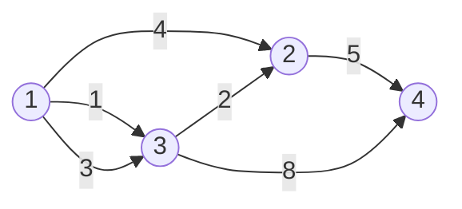
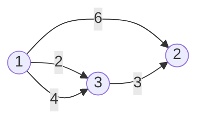

# Acompanhamento dos Marcos

# Marco 1 — Formulação

## 1. Enunciado

Existem `n` cidades e `m` conexões de voo. Cada voo sai de uma cidade `a`, chega a uma cidade `b` e tem um comprimento `c`. Os voos são só de ida.

O problema pede a **menor distância** da cidade `1` (Syrjälä) até cada uma das `n` cidades. É garantido que todas as cidades podem ser alcançadas a partir da cidade `1`.

## 2. Entrada

A primeira linha contém dois inteiros:

* `n` — quantidade de cidades, numeradas `1, 2, …, n`;
* `m` — quantidade de conexões de voo.

Em seguida, são fornecidas `m` linhas com três inteiros `a`, `b` e `c`:

| Valor | Significado |
|-------|-------------|
| `a` | cidade de origem do voo |
| `b` | cidade de destino do voo |
| `c` | comprimento (custo) do voo |

## 3. Saída

Uma única linha com `n` inteiros: a menor distância da cidade `1` até as cidades `1, 2, …, n`, nessa ordem.

A distância da cidade `1` até ela mesma é sempre `0`.

## 4. Objetivo

Para cada cidade `v`, encontrar o menor valor possível da soma dos comprimentos dos voos de uma rota que sai de `1` e chega em `v`.

## 5. Restrições

* `1 ≤ n ≤ 10⁵`;
* `1 ≤ m ≤ 2 · 10⁵`;
* `1 ≤ a, b ≤ n`;
* `1 ≤ c ≤ 10⁹`;
* limite de tempo: 1 s; limite de memória: 512 MB.

Como `c` pode chegar a `10⁹` e uma rota pode ter muitos voos, as distâncias podem passar do limite de um inteiro de 32 bits. Por isso, as distâncias precisam ser guardadas em inteiros de 64 bits (`long`).

## 6. Modelagem como Grafo

* **Vértices:** as cidades;
* **Arestas:** os voos, dirigidos de `a` para `b`;
* **Peso:** o comprimento `c` do voo;
* **Origem:** a cidade `1` (Syrjälä);
* **Tipo:** grafo dirigido e ponderado, com pesos positivos.

O grafo é dirigido porque existir o voo `a → b` não garante o voo `b → a`. O enunciado não proíbe voos repetidos entre as mesmas cidades, então podem existir **várias arestas** entre o mesmo par, com pesos diferentes. O grafo não é necessariamente simples.

## 7. Resultado de Aprendizagem

O problema afere o conceito de **caminho mínimo de origem única** em grafos ponderados. Diferente do T1 e do T2, não basta saber *se* uma cidade é alcançável, nem contar quantos passos são dados: o que importa é a **soma dos pesos** do caminho.

Um caminho com mais voos pode ser mais curto que um voo direto, se a soma dos seus pesos for menor. O algoritmo usado para encontrar essas distâncias é definido no marco 2.

## 8. Instância Pequena (criada pelo grupo)

Instância com 4 cidades e 6 voos, montada para ter os casos que importam no problema: um voo repetido e caminhos com mais voos que são mais baratos que o voo direto.

Entrada:

```text
4 6
1 2 4
1 3 1
1 3 3
3 2 2
2 4 5
3 4 8
```

| Voo | Origem | Destino | Comprimento |
|-----|--------|---------|-------------|
| 1 | 1 | 2 | 4 |
| 2 | 1 | 3 | 1 |
| 3 | 1 | 3 | 3 |
| 4 | 3 | 2 | 2 |
| 5 | 2 | 4 | 5 |
| 6 | 3 | 4 | 8 |



Saída esperada:

```text
0 3 1 8
```

* Cidade `1`: distância `0`, pois é a origem;
* Cidade `3`: entre os dois voos `1 → 3`, o de peso `1` é o melhor;
* Cidade `2`: o voo direto custa `4`, mas `1 → 3 → 2` custa `1 + 2 = 3`;
* Cidade `4`: o melhor caminho usa **três** voos, `1 → 3 → 2 → 4`, com custo `1 + 2 + 5 = 8`.

## 9. Exemplo do Enunciado

```text
3 4
1 2 6
1 3 2
3 2 3
1 3 4
```



Saída esperada:

```text
0 5 2
```

* Cidade `1`: distância `0`, pois é a origem;
* Cidade `2`: o voo direto custa `6`, mas a rota `1 → 3 → 2` custa `2 + 3 = 5`;
* Cidade `3`: existem dois voos `1 → 3`, com pesos `2` e `4`; o melhor é `2`.

---

# Marco 2 — Escolha do Algoritmo

## 1. Representação escolhida

Foi escolhida a **lista de adjacência**: cada cidade guarda a lista dos voos que **saem** dela.

Os motivos são:

* o grafo é **esparso**: `m ≤ 2 · 10⁵` é muito menor que `n² = 10¹⁰`. Uma matriz de adjacência `n × n` não caberia na memória;
* a lista ocupa `O(n + m)`, proporcional ao tamanho da entrada;
* para encontrar caminhos mínimos, a operação mais usada é "percorrer os voos que saem de `v`", e a lista entrega exatamente isso;
* a lista aceita **arestas paralelas** naturalmente. Uma matriz guardaria só um peso por par `(a, b)` e perderia informação.

## 2. Estrutura dos dados

Diferente do T2, a aresta agora carrega um **peso**. Por isso, cada item da lista de uma cidade guarda dois valores:

| Campo | Significado |
|-------|-------------|
| `destino` | cidade `b` onde o voo chega |
| `peso` | comprimento `c` do voo |

Ao ler a linha `a b c`, o par `(b, c)` é adicionado **apenas** à lista de `a`. Ele não é adicionado à lista de `b`, porque o voo é só de ida.

## 3. Representação da instância pequena

Lista de adjacência no formato `destino (peso)`:

```text
1: 2 (4), 3 (1), 3 (3)
2: 4 (5)
3: 2 (2), 4 (8)
4:
```

* A cidade `1` tem três voos de saída, incluindo os dois voos para `3`;
* A cidade `4` não tem voos de saída.

Total de itens nas listas: `3 + 1 + 2 + 0 = 6 = m`. Cada voo aparece exatamente uma vez, com sua direção e seu peso.

## 4. Validação da instância pequena

Como a instância é pequena, é possível listar todas as rotas que saem da cidade `1` e comparar os custos.

### Cidade 1

```text
dist(1) = 0
```

### Cidade 3

| Rota | Custo |
|------|-------|
| `1 → 3` (voo de peso 1) | 1 |
| `1 → 3` (voo de peso 3) | 3 |

```text
dist(3) = min{1, 3} = 1
```

### Cidade 2

| Rota | Custo |
|------|-------|
| `1 → 2` | 4 |
| `1 → 3 → 2` (voo de peso 1) | 1 + 2 = 3 |
| `1 → 3 → 2` (voo de peso 3) | 3 + 2 = 5 |

```text
dist(2) = min{4, 3, 5} = 3
```

### Cidade 4

| Rota | Custo |
|------|-------|
| `1 → 2 → 4` | 4 + 5 = 9 |
| `1 → 3 → 2 → 4` (voo de peso 1) | 1 + 2 + 5 = 8 |
| `1 → 3 → 2 → 4` (voo de peso 3) | 3 + 2 + 5 = 10 |
| `1 → 3 → 4` (voo de peso 1) | 1 + 8 = 9 |
| `1 → 3 → 4` (voo de peso 3) | 3 + 8 = 11 |

```text
dist(4) = min{9, 8, 10, 9, 11} = 8
```

Não existem outras rotas: o grafo não tem ciclos e a cidade `4` não tem voos de saída.

Saída esperada:

```text
dist(1..4) = [0, 3, 1, 8]
```

```text
0 3 1 8
```

## 5. Validação do exemplo do enunciado

Lista de adjacência:

```text
1: 2 (6), 3 (2), 3 (4)
2:
3: 2 (3)
```

| Cidade | Rotas possíveis | Menor custo |
|--------|-----------------|-------------|
| 1 | — | 0 |
| 2 | `1 → 2` = 6; `1 → 3 → 2` = 2 + 3 = 5 ou 4 + 3 = 7 | 5 |
| 3 | `1 → 3` = 2 ou 4 | 2 |

Saída esperada:

```text
0 5 2
```

As duas instâncias mostram dois pontos importantes do problema:

* um caminho com **mais voos** pode ser **mais curto** que o voo direto;
* entre arestas paralelas, só a de **menor peso** pode fazer parte de um caminho mínimo.

## 6. Classificação do problema

O problema é um **problema de caminhos mínimos de origem única** (*single-source shortest paths*) em um grafo:

* **dirigido** — os voos só vão de `a` para `b`;
* **ponderado** — cada voo tem um comprimento;
* com **pesos positivos** — `c ≥ 1`;
* com **origem fixa** — a cidade `1`;
* em que **todos os vértices são alcançáveis** a partir da origem.

Não é um problema de árvore geradora mínima, pois não se quer ligar todas as cidades com o menor custo total, e sim a menor distância de `1` até cada uma. Também não é um problema de fluxo, pois os pesos são comprimentos, não capacidades.

Por ser ponderado, uma busca em largura (BFS) não resolve o problema: ela minimiza a **quantidade** de voos, e não a **soma dos pesos**. Na instância do grupo, a BFS escolheria `1 → 2` (1 voo, custo 4) em vez de `1 → 3 → 2` (2 voos, custo 3).

## 7. Algoritmo escolhido: Dijkstra

Entre as famílias da unidade (Kruskal/Prim, Dijkstra e Ford-Fulkerson/Edmonds-Karp), a que corresponde ao problema é a de caminhos mínimos, então o algoritmo escolhido é o **Dijkstra**.

Ideia: manter uma estimativa `distTo[v]` para cada cidade e, a cada passo, retirar a cidade **ainda não processada com a menor estimativa**. Os voos que saem dela são usados para tentar melhorar as estimativas dos destinos (**relaxamento**).

Por que ele serve aqui:

* **pesos positivos** (`c ≥ 1`): quando uma cidade é retirada com a menor estimativa, nenhum caminho por outra cidade pode ficar mais barato depois, porque qualquer desvio só soma pesos positivos. Essa é a condição exigida pelo Dijkstra;
* **origem única**: o Dijkstra calcula, numa única execução, a distância da origem até **todas** as cidades, exatamente o que a saída pede;
* **arestas paralelas**: cada voo é relaxado separadamente, e o de menor peso vence naturalmente.

Alternativas descartadas:

| Algoritmo | Motivo do descarte |
|-----------|--------------------|
| BFS | minimiza o número de voos, não a soma dos pesos |
| Bellman-Ford | correto, mas custa `O(V · E)`, cerca de `2 · 10¹⁰` operações no pior caso; só é necessário com pesos negativos, que não existem aqui |
| Kruskal / Prim | constroem uma árvore geradora mínima, que não preserva as menores distâncias a partir de `1` |
| Ford-Fulkerson / Edmonds-Karp | resolvem fluxo máximo; os pesos aqui são comprimentos, não capacidades |

Implementação de referência: `algs4.DijkstraSP`, que usa uma fila de prioridade indexada (`IndexMinPQ`) para retirar a cidade de menor `distTo`.

## 8. Complexidade de pior caso

Considerando `V = n` cidades e `E = m` voos, com a `IndexMinPQ` (heap binário):

| Item | Quantidade | Custo de cada | Total |
|------|------------|---------------|-------|
| Inicialização de `distTo[]` e `edgeTo[]` | `V` | `O(1)` | `O(V)` |
| `delMin` (cada cidade sai da fila uma vez) | `V` | `O(log V)` | `O(V log V)` |
| Relaxamento (cada voo é examinado uma vez) | `E` | `O(1)` | `O(E)` |
| `insert` / `decreaseKey` (no máximo um por relaxamento) | `E` | `O(log V)` | `O(E log V)` |

* **Tempo:** `O((V + E) log V)`, que se escreve `O(E log V)` porque todas as cidades são alcançáveis a partir de `1`, então `E ≥ V − 1`;
* **Memória:** `O(V + E)`: a lista de adjacência ocupa `O(V + E)`, e `distTo[]`, `edgeTo[]` e a `IndexMinPQ` ocupam `O(V)`.

Com `V = 10⁵` e `E = 2 · 10⁵`, são cerca de `2 · 10⁵ · 17 ≈ 3,4 · 10⁶` operações de heap, folgado para o limite de 1 s.

---

# Marco 3 — Rastreamento Manual

Instância usada: a do grupo (marco 1, seção 8).

```text
4 6
1 2 4
1 3 1
1 3 3
3 2 2
2 4 5
3 4 8
```

Para facilitar a leitura, o rastreamento usa a numeração das cidades (`1..4`). No `algs4` os vértices começam em `0`, então a cidade `k` é o vértice `k − 1`. Essa conversão é feita no marco 4.

## 1. Estruturas de dados (algs4)

| Classe / campo | Papel |
|----------------|-------|
| `DirectedEdge` | um voo: `from()`, `to()` e `weight()` |
| `EdgeWeightedDigraph` | o grafo; `adj(v)` devolve os voos que saem de `v` |
| `Bag<DirectedEdge>` | lista de adjacência de cada cidade |
| `distTo[]` | menor distância conhecida da origem até cada cidade |
| `edgeTo[]` | último voo do melhor caminho conhecido até cada cidade |
| `IndexMinPQ<Double> pq` | cidades com estimativa pendente, ordenadas por `distTo` |

## 2. Estados iniciais

### Listas de adjacência

A `Bag` insere no início da lista, então os voos aparecem na ordem inversa da leitura:

```text
1: 1→3 (3), 1→3 (1), 1→2 (4)
2: 2→4 (5)
3: 3→4 (8), 3→2 (2)
4: —
```

### Vetores e fila

| Cidade | `distTo` | `edgeTo` |
|--------|----------|----------|
| 1 | 0 | — |
| 2 | ∞ | — |
| 3 | ∞ | — |
| 4 | ∞ | — |

```text
pq = { 1: 0 }
```

Só a origem começa na fila, com distância `0`. As demais começam com `∞`, ou seja, "ainda sem caminho conhecido".

## 3. Rastreamento

Cada `delMin` retira a cidade de menor `distTo`. Em seguida, cada voo `v → w` que sai dela é relaxado: se `distTo[w] > distTo[v] + peso`, a estimativa de `w` melhora. Se `w` já está na fila, usa-se `decreaseKey`; senão, `insert`.

| Passo | Operação | Teste | `distTo(1..4)` | `pq` |
|-------|----------|-------|----------------|------|
| 1 | `delMin` → `1` | — | `[0, ∞, ∞, ∞]` | `{ }` |
| 2 | relax `1→3 (3)` | `∞ > 0 + 3` ✓ `insert` | `[0, ∞, 3, ∞]` | `{3: 3}` |
| 3 | relax `1→3 (1)` | `3 > 0 + 1` ✓ `decreaseKey` | `[0, ∞, 1, ∞]` | `{3: 1}` |
| 4 | relax `1→2 (4)` | `∞ > 0 + 4` ✓ `insert` | `[0, 4, 1, ∞]` | `{3: 1, 2: 4}` |
| 5 | `delMin` → `3` | — | `[0, 4, 1, ∞]` | `{2: 4}` |
| 6 | relax `3→4 (8)` | `∞ > 1 + 8` ✓ `insert` | `[0, 4, 1, 9]` | `{2: 4, 4: 9}` |
| 7 | relax `3→2 (2)` | `4 > 1 + 2` ✓ `decreaseKey` | `[0, 3, 1, 9]` | `{2: 3, 4: 9}` |
| 8 | `delMin` → `2` | — | `[0, 3, 1, 9]` | `{4: 9}` |
| 9 | relax `2→4 (5)` | `9 > 3 + 5` ✓ `decreaseKey` | `[0, 3, 1, 8]` | `{4: 8}` |
| 10 | `delMin` → `4` | sem voos de saída | `[0, 3, 1, 8]` | `{ }` |

A fila ficou vazia, então o algoritmo termina.

Evolução de `edgeTo`:

| Cidade | Valores ao longo da execução | Final |
|--------|------------------------------|-------|
| 1 | — | — |
| 2 | `1→2 (4)` no passo 4, `3→2 (2)` no passo 7 | `3→2 (2)` |
| 3 | `1→3 (3)` no passo 2, `1→3 (1)` no passo 3 | `1→3 (1)` |
| 4 | `3→4 (8)` no passo 6, `2→4 (5)` no passo 9 | `2→4 (5)` |

## 4. Resultado

```text
distTo(1..4) = [0, 3, 1, 8]
```

```text
0 3 1 8
```

Igual à saída esperada validada no marco 2.

Os voos guardados em `edgeTo` formam a **árvore de caminhos mínimos** a partir da cidade `1`:


O caminho até uma cidade é recuperado voltando pelos `edgeTo` (é o que faz `pathTo` do `algs4`). Para a cidade `4`:

```text
edgeTo[4] = 2→4,  edgeTo[2] = 3→2,  edgeTo[3] = 1→3   ⇒   1 → 3 → 2 → 4
```

## 5. Justificativa das decisões e do resultado

* **Ordem de retirada:** as cidades saíram da fila na ordem `1, 3, 2, 4`, com distâncias `0, 1, 3, 8`, sempre crescentes. Como os pesos são positivos, quando uma cidade sai da fila sua distância é definitiva: nenhuma cidade que sai depois tem distância menor para oferecer um atalho. Por isso `distTo[3] = 1` e `distTo[2] = 3` nunca mudaram depois dos passos 5 e 8.
* **Voo repetido `1 → 3`:** pela ordem da `Bag`, o voo de peso `3` foi relaxado primeiro (passo 2) e depois melhorado pelo de peso `1` (passo 3, `decreaseKey`). A ordem dos voos na lista não altera o resultado, só o número de atualizações.
* **Caminhos com mais voos:** `distTo[2]` caiu de `4` (voo direto) para `3` (`1 → 3 → 2`), e `distTo[4]` caiu de `9` para `8` (`1 → 3 → 2 → 4`), confirmando o que foi visto na validação do marco 2.
* **Contagem de operações:** foram 4 `delMin` (uma por cidade) e 6 relaxamentos (um por voo), o que corresponde à análise de complexidade do marco 2.

## 6. Etapas explicadas no código algs4

### 6.1 Relaxamento — `relax` (Enzo Esmeraldo)

```java
private void relax(DirectedEdge e) {
    int v = e.from(), w = e.to();
    if (distTo[w] > distTo[v] + e.weight()) {
        distTo[w] = distTo[v] + e.weight();
        edgeTo[w] = e;
        if (pq.contains(w)) pq.decreaseKey(w, distTo[w]);
        else                pq.insert(w, distTo[w]);
    }
}
```

* O voo `e` vai de `v` para `w`;
* o `if` pergunta se chegar em `w` passando por `v` é mais barato do que o melhor caminho conhecido até `w`;
* se for, `distTo[w]` recebe a nova distância e `edgeTo[w]` guarda o voo usado;
* por fim, a fila é atualizada: se `w` já estava pendente, sua prioridade diminui (`decreaseKey`); se não, ele entra na fila (`insert`).

Na instância, o passo 7 é um exemplo: `distTo[2] = 4 > 1 + 2`, então `distTo[2] = 3`, `edgeTo[2] = 3→2` e `decreaseKey(2, 3)`.

### 6.2 Laço principal — construtor de `DijkstraSP` (Gustavo Andrade)

```java
for (int v = 0; v < G.V(); v++)
    distTo[v] = Double.POSITIVE_INFINITY;
distTo[s] = 0.0;

pq = new IndexMinPQ<Double>(G.V());
pq.insert(s, distTo[s]);
while (!pq.isEmpty()) {
    int v = pq.delMin();
    for (DirectedEdge e : G.adj(v))
        relax(e);
}
```

* Todas as distâncias começam em `∞`, menos a origem `s`, que começa em `0`;
* a fila começa só com a origem;
* enquanto houver cidades pendentes, `delMin` retira a de menor `distTo`, que a partir daí é definitiva;
* todos os voos que saem dela são relaxados, o que pode inserir ou atualizar outras cidades na fila.

Na instância, o laço rodou 4 vezes (passos 1, 5, 8 e 10), uma para cada cidade.

## 7. Observações para o marco 4

* converter as cidades `1..n` para os vértices `0..n-1`;
* trocar `double` por `long` em `distTo[]` e nos pesos, para garantir valores inteiros exatos (distâncias de até cerca de `10¹⁴`);
* trocar `StdIn` por uma leitura mais rápida, já que são até 200.000 voos.
